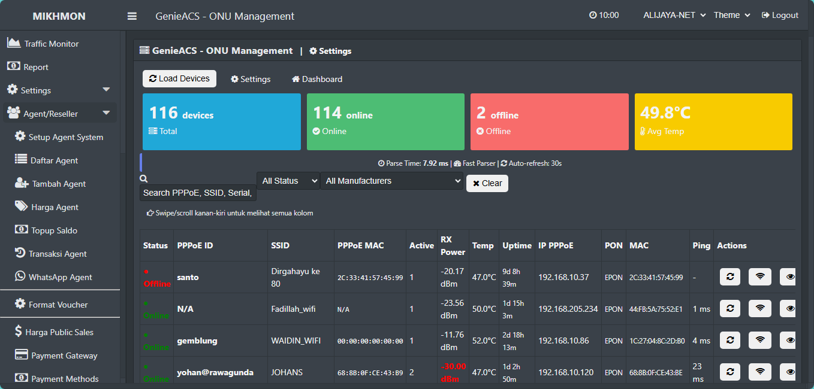
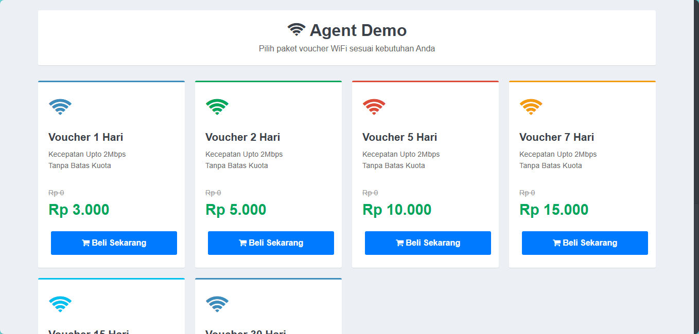

# 🚀 MikhMon Agent System

[](https://www.php.net/)
[](LICENSE)
[](https://github.com/alijayanet/mikhmon-agent/stargazers)

**Sistem Penjualan Voucher WiFi Otomatis untuk MikroTik Hotspot dengan Fitur Agent/Reseller, Payment Gateway, dan WhatsApp Integration**

---


## 📸 Screenshot

### Dashboard Agent

*Dashboard agent dengan ringkasan saldo dan statistik*

### Generate Voucher

*Form generate voucher dengan preview modern*

### Dasboard Genieacs

*Monitoring Genieacs*

### Voucher Preview

*Preview laporan penjualan Voucher Online*

### Admin Panel

*Panel administrasi untuk manajemen agen dan harga*

### Public Order Page

*Landing page untuk pembelian langsung oleh customer link :https://yourdomain.com/public/index.php?agent=AG001*

## 📖 Tentang Proyek

MikhMon Agent System adalah solusi komprehensif untuk manajemen penjualan voucher WiFi berbasis MikroTik Hotspot dengan sistem agen/reseller. Sistem ini memungkinkan pemilik hotspot untuk menjual voucher melalui agen-agen mereka, menerima pembayaran otomatis, dan mengelola seluruh operasional melalui antarmuka yang intuitif.

Proyek ini merupakan pengembangan lanjutan dari [MikhMon V3](https://github.com/laksa19/mikhmonv3) dengan penambahan fitur-fitur bisnis yang lengkap.

## 🌟 Fitur Utama

### 🤝 Sistem Agent/Reseller
- Multi-level agent dengan pengaturan harga khusus
- Manajemen saldo dan transaksi agen
- Sistem komisi otomatis
- Topup saldo melalui berbagai metode pembayaran

### 💳 Payment Gateway Integration
- Integrasi dengan 12+ metode pembayaran (QRIS, Virtual Account, E-Wallet)
- Support Tripay, Xendit, dan gateway lainnya
- Manajemen transaksi otomatis
- Notifikasi pembayaran real-time

### 📱 WhatsApp Integration
- Webhook commands untuk customer dan agent
- Notifikasi otomatis via WhatsApp
- Sistem broadcast pesan
- Customer service bot

### 🎟️ Manajemen Voucher
- Generate voucher otomatis
- Template voucher yang dapat dikustomisasi
- Print voucher (thermal & normal)
- Tracking status voucher (active, used, expired)

### 📊 Dashboard & Reporting
- Dashboard real-time untuk agent
- Laporan penjualan harian/mingguan/bulanan
- Statistik performa agen
- Export data ke berbagai format

### 🔧 Fitur Teknis
- Responsive design (mobile-friendly)
- RESTful API untuk integrasi
- Multi-session MikroTik
- One-click installation
- Auto-fix compatibility issues


### Komponen Utama:
1. **Frontend Public** - Landing page untuk pembelian langsung
2. **Agent Panel** - Dashboard untuk agen/reseller
3. **Admin Panel** - Kontrol penuh untuk administrator
4. **API Layer** - RESTful API untuk integrasi
5. **Payment Gateway** - Integrasi pembayaran otomatis
6. **WhatsApp Integration** - Bot dan notifikasi WhatsApp
7. **Database Layer** - MySQL dengan struktur teroptimasi

## 🚀 Instalasi

### Prasyarat
- **PHP 7.4+** (Rekomendasi: PHP 8.1+)
- **MySQL 5.7+** atau **MariaDB 10.3+**
- **Web Server**: Apache / Nginx
- **MikroTik RouterOS** (untuk fitur voucher hotspot)

---

### 📦 Instalasi Cepat (Fresh Server)

#### Langkah 1 – Download & Upload File
```bash
# Via Git:
git clone https://github.com/alijayanet/mikhmon-agent.git

# Atau download ZIP lalu upload ke hosting / VPS,
# ekstrak ke direktori web (public_html / htdocs / www)
```

#### Langkah 2 – Buat Database MySQL
Buat database kosong di phpMyAdmin atau via CLI:
```sql
CREATE DATABASE `mikhmon_agent` CHARACTER SET utf8mb4 COLLATE utf8mb4_unicode_ci;
```

#### Langkah 3 – Jalankan Installer
Akses melalui browser:
```
http://domain-anda.com/install.php
```
Ikuti wizard:
1. Isi **DB Host**, **DB User**, **DB Password**, **DB Name** → Simpan
2. Klik **"Jalankan Instalasi"** — semua tabel akan dibuat otomatis
3. Tunggu hingga muncul **"✅ INSTALASI SELESAI!"**
4. **Hapus `install.php`** setelah selesai (wajib untuk keamanan)

#### Langkah 4 – Setup Cronjob (Wajib untuk Billing)
Akses halaman berikut untuk mendapatkan perintah cronjob yang tepat:
```
http://domain-anda.com/check_cron_path.php
```
Tambahkan ke cron server (biasanya via cPanel / contab):
```bash
# Jalankan setiap jam untuk isolasi & reminder tagihan
0 * * * * /usr/bin/php /path/to/mikhmon-agent/cron/billing_cron.php
```

---

### ⚙️ Konfigurasi Fitur Tambahan

#### 📱 WhatsApp Integration
1. Daftar di gateway WhatsApp: **[Fonnte](https://fonnte.com)** / Wablas / WooWA / MPWA
2. Dapatkan API Token
3. Konfigurasi di: `Settings → WhatsApp Settings` atau langsung:
   ```
   http://domain-anda.com/settings/whatsapp_settings.php
   ```

#### 🤖 Telegram Bot
1. Buat bot di [@BotFather](https://t.me/BotFather), dapatkan **Bot Token**
2. Konfigurasi di: `Settings → Telegram Settings`:
   ```
   http://domain-anda.com/settings/telegram_settings.php
   ```
3. Set webhook URL ke: `https://domain-anda.com/api/telegram_webhook.php`

#### 💳 Payment Gateway (Topup Agen)
1. Daftar di **[Tripay](https://tripay.co.id)** / Xendit / Duitku
2. Dapatkan **API Key** & **Private Key**
3. Konfigurasi di:
   ```
   http://domain-anda.com/agent-admin/payment_gateway_config.php
   ```

#### 📡 GenieACS (Manajemen ONU/ONT)
1. Install GenieACS di server terpisah
2. Konfigurasi URL, username, password di:
   ```
   Billing Settings → GenieACS URL / Username / Password
   ```

#### 🔌 Digiflazz (Pulsa & Paket Data)
1. Daftar di **[Digiflazz](https://digiflazz.com)**
2. Dapatkan **Username** & **API Key**
3. Aktifkan di Agent Settings: `digiflazz_enabled = 1`

---

### 🌐 URL Panel Utama

| Panel | URL |
|---|---|
| Agent Dashboard | `/agent/` |
| Admin Panel | `/agent-admin/` |
| Portal Pelanggan (Billing) | `/public/billing_login.php` |
| Halaman Pembelian Publik | `/public/index.php?agent=AG001` |
| Telegram Settings | `/settings/telegram_settings.php` |
| WhatsApp Settings | `/settings/whatsapp_settings.php` |

---

### Konfigurasi Lanjutan (Opsional)

#### GenieACS Device Management
Edit konfigurasi di `billing_settings`:
- `genieacs_url` → URL server GenieACS
- `genieacs_username` / `genieacs_password` → kredensial API

#### Billing Pelanggan Bulanan
1. Tambah **Profil Paket** di `/billing/profiles.php`
2. Daftarkan **Pelanggan** di `/billing/customers.php`
3. Invoice akan dibuat otomatis setiap bulan via cronjob


- **Backend**: PHP 7.4+, MySQL/MariaDB
- **Frontend**: HTML5, CSS3, JavaScript, Bootstrap 4
- **Router Integration**: MikroTik RouterOS API
- **Payment**: Tripay, Xendit, Duitku API
- **Messaging**: WhatsApp Webhook Integration
- **Charting**: Highcharts
- **QR Code**: Google Charts API
- **UI Framework**: Custom MikhMon UI

## 🤝 Kontribusi

Kontribusi sangat kami nantikan! Untuk berkontribusi:

1. Fork proyek ini
2. Buat branch fitur (`git checkout -b feature/AmazingFeature`)
3. Commit perubahan (`git commit -m 'Add some AmazingFeature'`)
4. Push ke branch (`git push origin feature/AmazingFeature`)
5. Buka Pull Request

### Panduan Kontribusi
- Ikuti standar penulisan kode PHP PSR-12
- Tambahkan komentar kode yang jelas
- Uji perubahan sebelum submit
- Perbarui dokumentasi jika diperlukan

## 📄 Lisensi

Distributed under the MIT License. See [LICENSE](LICENSE) for more information.

## 📞 Kontak

**Ali Jaya Net** - [@alijayanet](https://github.com/alijayanet)

Project Link: [https://github.com/alijayanet/mikhmon-agent](https://github.com/alijayanet/mikhmon-agent)

## 🙏 Acknowledgements

- [MikhMon V3](https://github.com/laksa19/mikhmonv3) - Base system
- [RouterOS API](https://wiki.mikrotik.com/wiki/Manual:API) - MikroTik integration
- [Font Awesome](https://fontawesome.com/) - Icons
- [Bootstrap](https://getbootstrap.com/) - CSS Framework
- [Highcharts](https://www.highcharts.com/) - Charting library

---

<p align="center">
  Made with ❤️ by Ali Jaya Net

</p>


